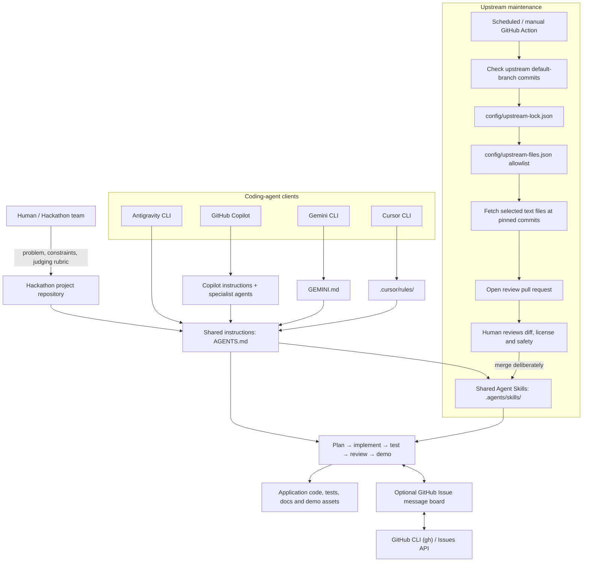
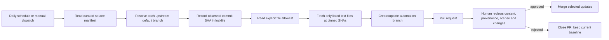

# Architecture

This repository is a **starter kit and coordination layer**, not an agent runtime. It gives supported coding-agent clients a common set of project rules and skills, while keeping each client's native configuration small.

## System overview



## Runtime responsibilities

| Component | Responsibility | What it does not do |
|---|---|---|
| `AGENTS.md` | Shared engineering, safety, Git and collaboration contract | Does not configure or launch an agent client |
| Host configuration | Points each client to shared instructions and relevant native profiles | Host support and discovery vary by client/version |
| `.agents/skills/` | Reusable task playbooks in `SKILL.md` format | Does not guarantee automatic discovery by every host |
| `.github/agents/` | Copilot specialist profiles for planning, frontend, testing and review | Not independent background services |
| `tools/board` | Posts, reads, filters and waits for comments on one GitHub Issue | Not a scheduler, task queue, lock manager or merge system |
| `scripts/setup-board.sh` | Creates or finds and pins the board issue | Does not configure each agent's shell environment |
| Upstream workflows | Detect changes, sync allowlisted files and open a PR | Do not bulk-import repositories or auto-merge |

## Agent task lifecycle

```mermaid
sequenceDiagram
    actor Human
    participant Planner as Planner agent
    participant Shared as AGENTS.md + skills
    participant Board as GitHub Issue board
    participant Worker as Specialist agent
    participant Integrator as Integrator / reviewer
    Human->>Planner: Problem statement, deadline, constraints, judging rubric
    Planner->>Shared: Read project contract and planning skills
    Planner->>Human: MVP, architecture, acceptance criteria, task ownership
    Planner->>Board: Publish ownership and interface contracts (if enabled)
    Human->>Worker: Assign task with exclusive file ownership
    Worker->>Shared: Read instructions and relevant skill
    Worker->>Board: Check unread messages; post progress/blockers
    Worker->>Integrator: Deliver implementation and test evidence
    Integrator->>Integrator: Review interfaces, run tests, inspect diff
    Integrator->>Human: Demo-ready status, limitations and demo script
```

## Upstream update lifecycle



The current sync allowlist imports two selected skills and the GitHub Awesome Copilot license. Other repositories in `config/upstream-sources.json` are tracked for discovery/update awareness but are not bulk-imported.

## Design decisions

1. **Shared rules, native adapters.** Keep project-wide behavior in `AGENTS.md`; host-specific files stay short and direct the client to it.
2. **Human-owned integration.** Agents work in bounded areas; one integrator owns interface checks, test runs and merging.
3. **Explicit coordination.** The Issue board is optional. File ownership and Git branches/worktrees remain the safeguards against concurrent edits.
4. **Allowlist over bulk sync.** Only declared files are copied, from pinned commits. Review is required before adoption.
5. **No secrets in the template.** Each generated project supplies its own environment variables and local `.env.example`; credentials are never part of this boilerplate.
6. **Verify host compatibility.** Agent Skills and configuration discovery vary. Check the installed client version and official docs rather than assuming identical behavior.
