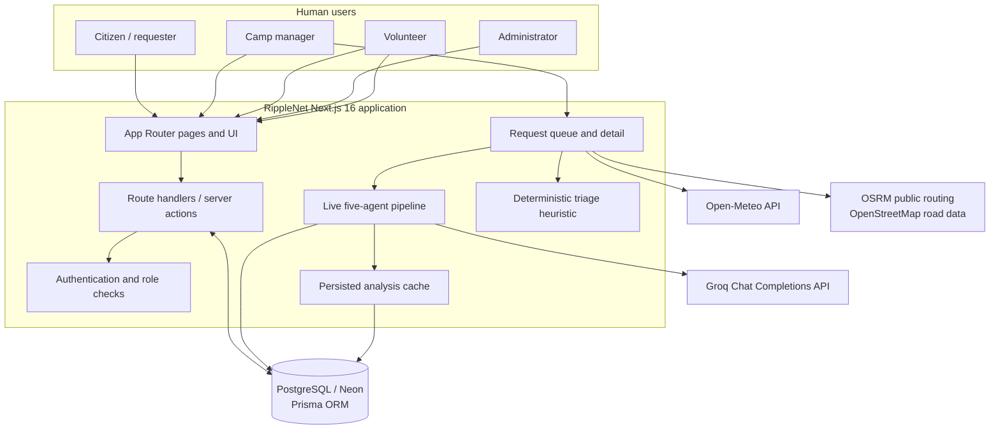
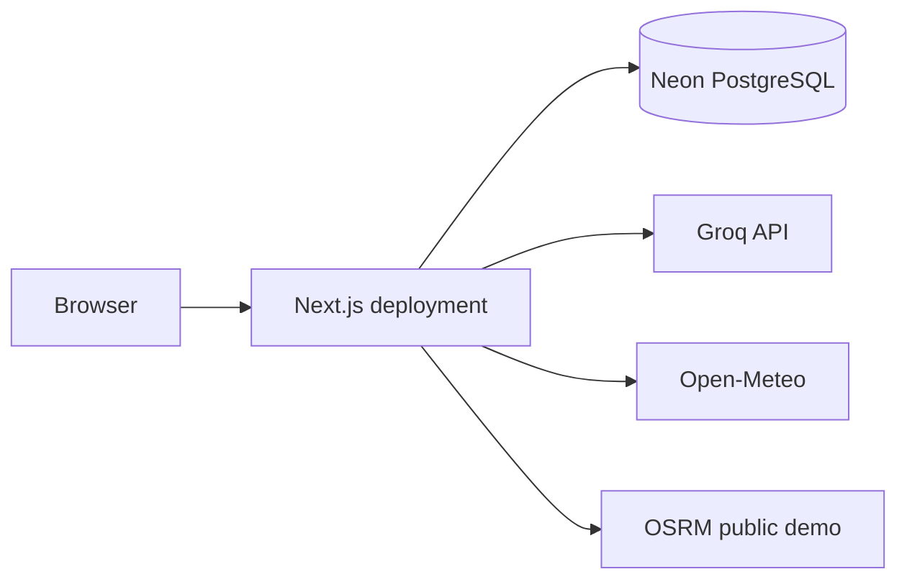

# RippleNet AI — System Architecture

This document describes the **implemented hackathon prototype**, not the earlier product roadmap. The current application is a Next.js monolith backed by PostgreSQL/Prisma, with server-side integrations for Groq, Open-Meteo, and OSRM.

## Context diagram



## Live request-analysis sequence

```mermaid
sequenceDiagram
  actor Manager as Camp manager
  participant Page as /queue/[id]
  participant DB as Prisma / PostgreSQL
  participant Weather as Open-Meteo
  participant OSRM as OSRM
  participant Agents as Live pipeline
  participant Groq as Groq API

  Manager->>Page: Open request detail
  Page->>DB: Load request, camp, stock and cached analysis
  alt Cached analysis is fresh and no refresh requested
    DB-->>Page: Return saved agentAnalysis
  else Cache missing, expired, or explicitly refreshed
    par Fetch weather evidence
      Page->>Weather: Request observed/forecast precipitation
      Weather-->>Page: Rainfall values or unavailable
    and Fetch road route
      Page->>OSRM: Request road-network route
      OSRM-->>Page: Distance/ETA or unavailable
    end
    Page->>Agents: Build bounded request context
    par Flood evidence agent
      Agents->>Groq: JSON completion
      Groq-->>Agents: Structured response
    and Health triage agent
      Agents->>Groq: JSON completion
      Groq-->>Agents: Structured response
    and Logistics planning agent
      Agents->>Groq: JSON completion
      Groq-->>Agents: Structured response
    and Route information agent
      Agents->>Groq: JSON completion
      Groq-->>Agents: Structured response
    and Resource transparency agent
      Agents->>Groq: JSON completion
      Groq-->>Agents: Structured response
    end
    Agents->>Agents: Normalize output and check stock locally
    Agents-->>Page: Per-agent status, summaries, evidence and limitations
    Page->>DB: Persist JSON analysis and evaluatedAt timestamp
  end
  Page-->>Manager: Show advisory findings; manager retains control
```

## Runtime components

| Component | Source location | Responsibility |
|---|---|---|
| Web application | `app/**` | Next.js App Router pages, layouts, and API route handlers |
| Prisma client | `lib/db.ts` | Shared database client |
| Live agent orchestrator | `lib/agents/live.ts` | Defines five agent tasks, concurrent execution, output normalization, evidence and result shape |
| Groq adapter | `lib/ai/groq.ts` | Server-only HTTP client for Groq's OpenAI-compatible JSON Chat Completions endpoint |
| Risk heuristic | `lib/risk.ts` | Deterministic request triage score |
| Weather/rainfall | `lib/geo.ts` and weather integration | Geographic helpers and rainfall evidence types/calculation |
| Road routing | `lib/osrm.ts` | OSRM route distance, duration and geometry |
| Database schema | `prisma/schema.prisma` | Users, camps, requests, stock, complaints, restock requests and AI-analysis cache |

## Request lifecycle

1. **Intake:** the request route validates and persists the submitted request. A successful response is backed by a database write; it should not be interpreted as proof that a volunteer has been dispatched.
2. **Queue:** the camp queue reads persisted requests and presents the deterministic triage score alongside request metadata.
3. **Context gathering:** request detail loads the request and relevant camp inventory, plus available rainfall and route evidence.
4. **Advisory analysis:** the server invokes the five Groq-backed agents concurrently. Each agent has its own prompt, typed output contract, and failure boundary.
5. **Normalization:** output strings and arrays are bounded; enum values are checked; logistics item quantities/units are validated and compared to stock records on the server.
6. **Persistence:** the combined analysis is serialized into `Request.agentAnalysis`, with `Request.agentAnalysisAt` marking the evaluation time.
7. **Human execution:** a camp manager reviews the evidence and performs operational actions through the application. AI output itself does not dispatch or reserve resources.
8. **Volunteer view:** volunteer task detail reads persisted request and analysis information. It does not launch a second set of model calls.

## Five-agent topology

All five tasks call the same server-only Groq adapter, but receive different instructions and evidence scopes.

| Agent | Input evidence | Output focus | Does not do |
|---|---|---|---|
| Flood Evidence | Incident type, reported needs, observed and forecast rainfall | Precipitation signal, supporting values, limitations | Infer flood depth, inundation, river level, soil saturation, or road flooding |
| Health Triage Support | Explicitly reported needs and incident context | Urgency category, reported signals, red flags, safe next steps | Diagnose, prescribe, infer unreported symptoms, or estimate outbreaks |
| Logistics Planning | Incident type, reported needs | Relief-item suggestions, quantities, units, packing notes | Reserve stock, dispatch, deduct inventory, or create restock requests |
| Route Information | Request context and OSRM route distance/ETA | Route summary and cautions | Verify road passability, closures, detours, or vehicle suitability |
| Resource Transparency | Request context | Explain why verified cost estimate is unavailable | Invent unit prices, freight rates, or totals |

The pipeline's output includes provider/model metadata, per-agent status, summaries, evidence, structured output, errors, overall heuristic score, and a concise justification block. Hidden chain-of-thought is not a product output.

## Data and trust boundaries

- **Browser → application:** the browser never supplies the Groq API key. The adapter reads `GROQ_API_KEY` from server environment variables.
- **Application → Groq:** prompts contain a minimized request context. Direct identifiers and GPS coordinates are not deliberately included; common email, phone and coordinate patterns in reported-needs text are redacted. Free text may still contain sensitive information.
- **Application → inventory:** the database stock snapshot is not sent to Groq. Model-suggested item names, quantities and units are checked locally using exact normalized item-name and unit matches.
- **External weather/routing → application:** missing or failed external data is represented as unavailable; the application must not fabricate fallback readings.
- **AI → operational state:** agent output is advisory. It cannot independently assign volunteers, change request status, reserve stock, or dispatch aid.

## Caching and failure behavior

- The request stores the combined analysis JSON and timestamp.
- Fresh cached analysis is reused for ten minutes.
- A manager can explicitly request a refresh using the page's refresh action.
- Each agent is wrapped independently. One failure does not require the other agents to be represented as successful.
- Groq requests use JSON mode, low temperature, a bounded completion size, and a 25-second timeout by default.
- Missing API configuration, rate limits, provider errors, timeouts, empty content, or invalid JSON are surfaced as failures rather than replaced with fabricated results.

## Deployment shape



The deployed application needs server-side database and Groq environment variables. External service availability, rate limits, and usage policies apply. The public OSRM demo endpoint is not a guaranteed production SLA.

## Architecture decisions

1. **One deployable application:** the current prototype uses Next.js route handlers and server-side libraries rather than a separate FastAPI service.
2. **Database as source of truth:** request, camp, volunteer, stock, complaint and restock records are persisted in PostgreSQL through Prisma.
3. **AI is advisory:** deterministic business logic and human authorization remain outside the model.
4. **Parallel specialized agents:** independent analysis tasks run concurrently to reduce serial latency and make partial failures visible.
5. **Evidence-first output:** every agent has a narrow scope and reports limitations; unsupported data remains unavailable.
6. **No hidden operational side effects:** suggestions do not silently reserve stock or dispatch volunteers.
