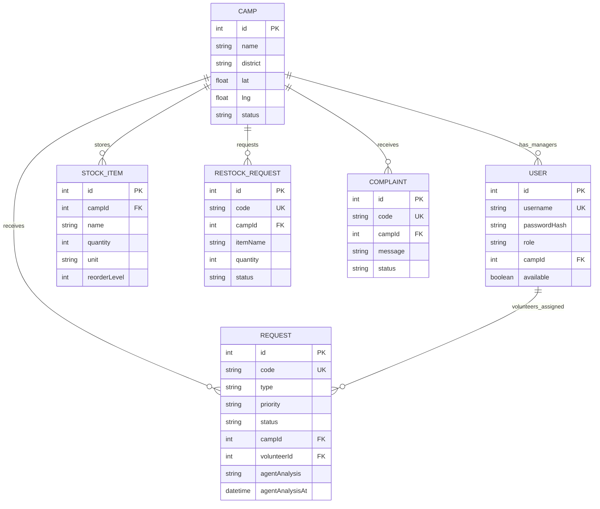

# Data Model

The current schema is defined in [`prisma/schema.prisma`](../prisma/schema.prisma). PostgreSQL is the source of truth; Prisma Client is used by the Next.js server.

## Entity overview

## Models

### User

Application identity with a unique username, password hash, role, optional camp association, availability state, and relation to assigned volunteer tasks. Roles in the schema are stored as strings; the current expected values are `admin`, `camp_manager`, and `volunteer`.

### Camp

Operational camp record with district/province, coordinates, phone, capacity, occupancy and status. Camps relate to managers, requests, inventory, restock requests and complaints.

### Request

Citizen assistance request containing a unique public tracking code, request type, priority, needs, district, coordinates, people count and operational status. Optional camp and volunteer relations record assignment. Lifecycle timestamps include assignment, transit start and resolution.

The AI feature adds:

- `agentAnalysis`: nullable serialized JSON containing the combined advisory analysis.
- `agentAnalysisAt`: nullable timestamp used for cache freshness.

The AI cache is not a replacement for the request's operational status or dispatch record.

### StockItem

Camp inventory row with item name/category, quantity, unit and reorder threshold. The live logistics agent compares its proposed items to these rows on the server. Matching is based on normalized exact item name and unit; it is not a fuzzy semantic stock search.

### RestockRequest

A camp's request to replenish an item, with quantity and workflow status. AI logistics suggestions do not automatically create a restock request.

### Complaint

Complaint record with unique code, reporter details, message/category, optional camp, status, response and timestamps.

## Request status and ownership

The request model currently stores status as a string rather than a Prisma enum. Consult route handlers and UI transitions for the allowed values and permitted transitions. Do not assume the earlier planning document's longer state machine is implemented.

## Data integrity notes

- Unique constraints exist for usernames, request codes, complaint codes and restock codes.
- Camp and volunteer relationships are nullable where the workflow permits an unassigned record.
- Inventory quantity and unit are stored in database rows; AI suggestions do not mutate these values.
- The AI analysis JSON is advisory and may contain partial agent failures.
- Do not store real citizen information in development/demo databases unless there is a lawful basis, access control, and appropriate retention policy.
